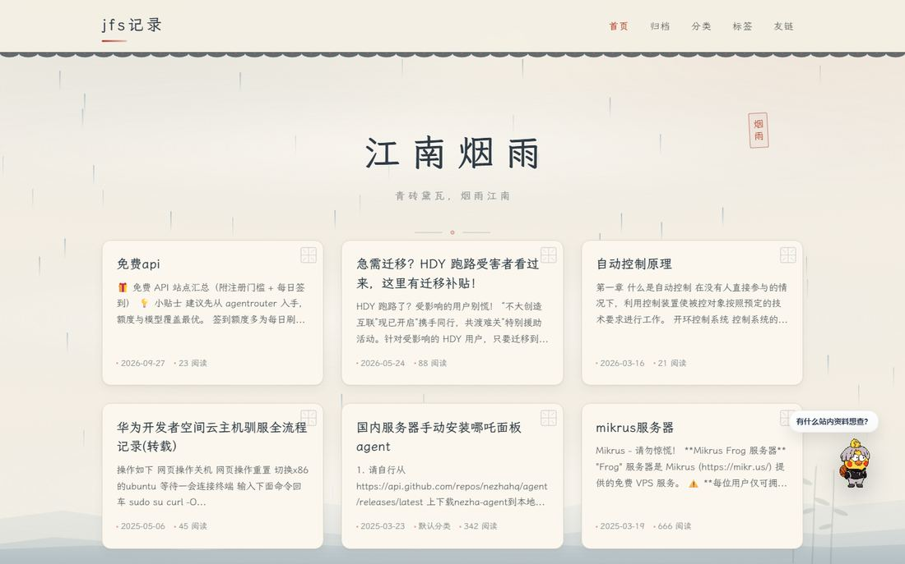
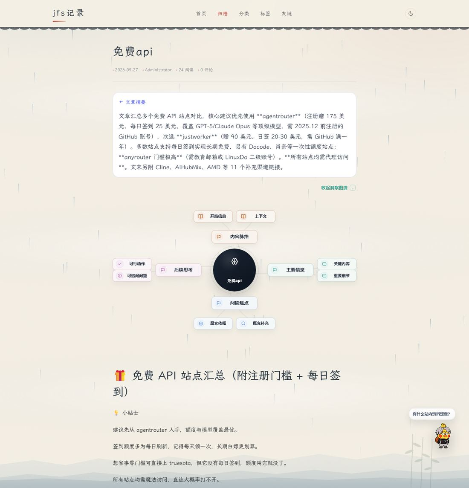
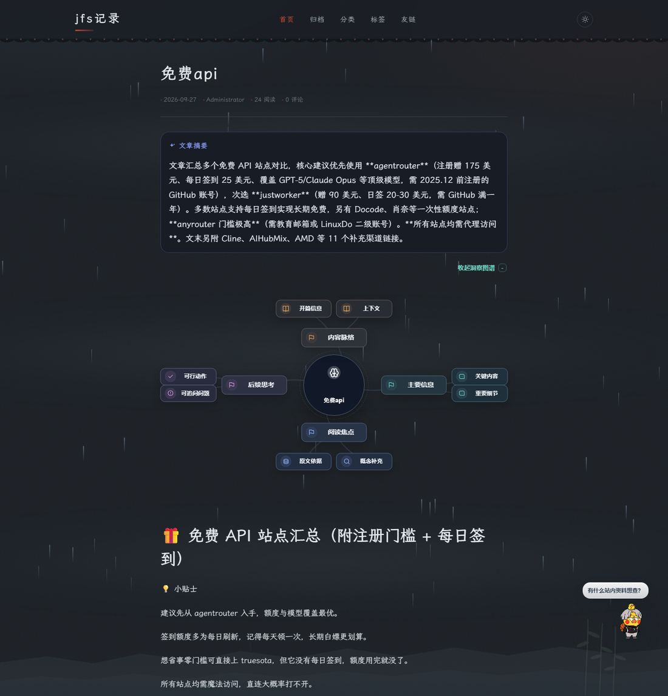

# 江南烟雨 · Jiangnan Misty Rain

一款为 [Halo 2.x](https://halo.run) 编写的中国古典建筑风格主题。青砖黛瓦、远山如黛、细雨如丝，让每一篇文字都落在江南的烟雨里。



## 预览

| 文章页（浅色） | 文章页（深色） |
| --- | --- |
|  |  |

## 特性

**古建筑语汇**
- 导航栏下沿的瓦当檐口装饰带
- 文章卡片右上角的窗棂纹样
- 首页题头的朱红「烟雨」竖排印章
- 页脚上方的拱桥石栏剪影

**江南山水**
- 页面底部三层远山剪影，压淡为水汽感，不干扰阅读
- 缓慢飘移的三层水汽 + 桌面端细雨（移动端自动减半）
- 宣纸纹理底 + 水墨晕染光晕

**排版与可用性**
- 霞鹜文楷标题，宋体兜底；正文 1.95 行距
- 竹青引文、黛瓦代码块，表格/图片/上下篇完整适配
- 深浅双模式：跟随系统 / 手动切换 / 记住选择，首屏无闪烁
- 响应式：桌面、平板、手机，支持 `prefers-reduced-motion`
- 适配 AI 摘要、洞察图谱等插件卡片配色（浅色纸墨 / 深色夜航两套）

## 环境要求

- Halo `>= 2.20.0`

## 安装

**方式一：后台安装（推荐）**

1. 下载本仓库（`Code → Download ZIP`，或 Releases 中的 zip）
2. 进入 Halo 后台 → 外观 → 主题 → 安装主题，上传 zip
3. 启用「江南烟雨」

> zip 解压后的根目录必须直接包含 `theme.yaml`。若压缩包里多套了一层文件夹，请重新打包。

**方式二：手动放置**

```bash
cd ~/.halo2/themes          # 或你的 Halo 工作目录下的 themes
unzip jiangnan-misty-rain.zip
```

然后重启 Halo，主题列表中会出现「江南烟雨」。

## 主题设置

后台 → 外观 → 主题 → 江南烟雨 → 设置：

| 分组 | 设置项 | 说明 |
| --- | --- | --- |
| 基础设置 | 首页大标题 | 留空则使用站点标题 |
| 基础设置 | 首页副标题 | 大标题下方的一句话 |
| 基础设置 | 页脚诗句 | 默认「君到姑苏见，人家尽枕河」 |
| 基础设置 | 强调色 | 按钮、悬停等强调色，默认梅红 `#B4432F` |
| 氛围效果 | 显示雨滴 / 烟雾 / 远山 | 可单独关闭，减少动画开销 |
| 氛围效果 | 雨滴数量 | 桌面端数量，建议 40–120，移动端自动减半 |

**备案号**不在主题里写死：它来自 Halo 后台「系统设置 → 代码注入 → 页脚」，由模板中的 `<halo:footer />` 输出，位置在页脚版权行下方。改备案号只需改后台设置。

## 目录结构

```
jiangnan-misty-rain/
├── theme.yaml              # 主题元信息
├── settings.yaml           # 后台设置表单定义
├── docs/                   # 预览图
└── templates/
    ├── layout.html         # 公共骨架：导航、页脚、装饰层、脚本
    ├── index.html          # 首页
    ├── post.html           # 文章详情
    ├── page.html           # 独立页面
    ├── archives.html       # 归档
    ├── categories.html     # 分类总览
    ├── category.html       # 分类详情
    ├── tags.html           # 标签总览
    ├── tag.html            # 标签详情
    ├── links.html          # 友链
    ├── error.html          # 404
    └── assets/
        ├── css/main.css    # 全部样式（约 36 KB）
        └── images/logo.svg
```

## 二次开发注意

- **静态资源映射**：`templates/assets/**` 对外映射为 `/themes/<主题id>/assets/**`，新增资源请放在 `templates/assets` 下。
- **模板会缓存**：Halo 会缓存编译后的模板，修改 `.html` 或 `.css` 后需重启 Halo（或后台重载主题）才生效。
- **样式缓存**：`layout.html` 里 CSS 引用带 `?v=${theme.spec.version}`，改动后请同步提升 `theme.yaml` 的 `version`，否则浏览器会命中旧缓存。
- **布局插槽**：模板统一使用官方签名 `layout :: html(head, content)`，页面通过 `th:replace` 传入 `content = ~{::content}`。
- **代码注入**：`<halo:footer />` 必须存在，否则后台「代码注入 → 页脚」的内容（备案号、部分插件脚本）不会输出。

## 更新日志

- **1.2.3** 备案号挪入页脚内部，修复 `min-height:100vh` 导致注入区悬在折叠线下方的问题
- **1.2.2** 新增 `<halo:footer />` 代码注入点，找回 ICP 与公安备案
- **1.2.1** 文楷字体改用 gcore 镜像并非阻塞加载；字体栈补全中文兜底
- **1.2.0** 新增深色模式、插件卡片配色适配、导航路径高亮；移除国内不可达的 Google Fonts
- **1.1.1** 修复小屏横向溢出
- **1.1.0** 新增友链页
- **1.0.0** 首个版本：江南烟雨古建筑风格

## 致谢

- 字体：[霞鹜文楷 LXGW WenKai](https://github.com/lxgw/LxgwWenKai)（SIL Open Font License 1.1）
- 博客系统：[Halo](https://halo.run)

## 许可

[MIT](LICENSE)

---

作者：jfsv.cn · https://www.jfsv.cn
